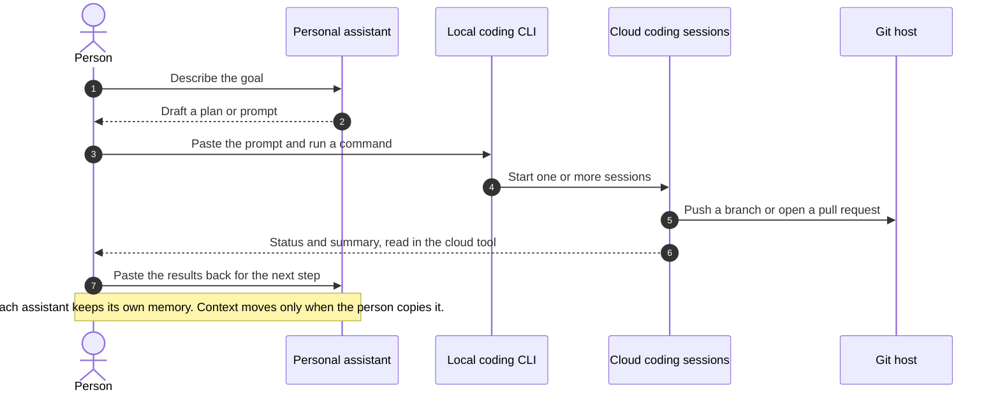
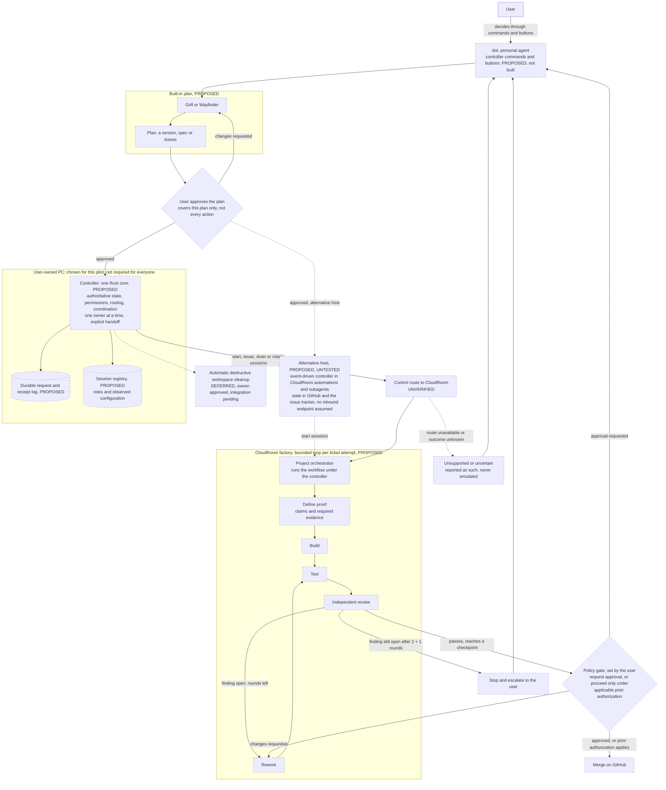
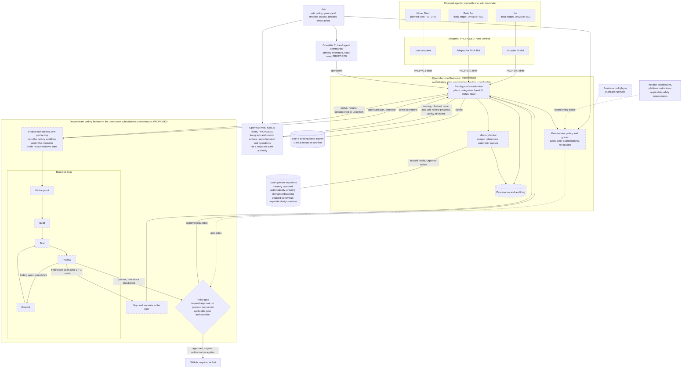
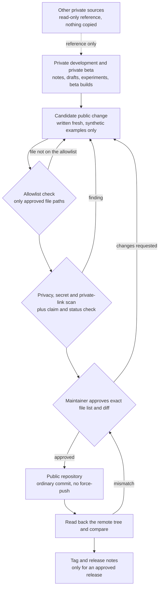
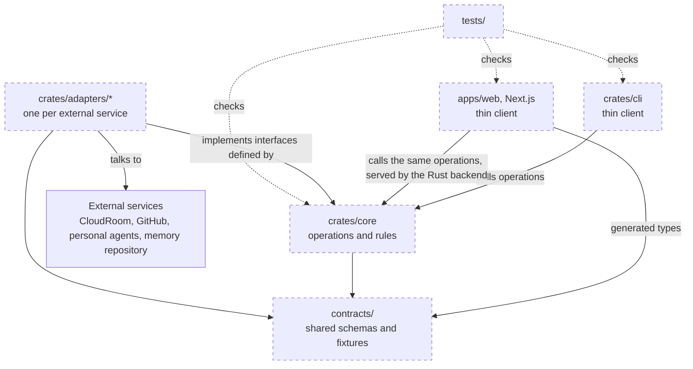

# Architecture diagrams

These diagrams are Mermaid source; GitHub renders them in place. Each node is labelled **Current**, **Unverified**, **Proposed**, **Deferred** or **Future**. Dashed outlines mark anything that is not current behaviour.


*Product architecture image. Editable source: [openwiz-architecture.svg](assets/openwiz-architecture.svg). The Mermaid diagrams below are the detailed versions.*

## 1. Current: the manual workflow

**Status: Current.** This is how work moves today, entirely by hand. No OpenWiz software is involved. The person is the integration layer.



## 2. First pilot: dot → controller on a user-owned PC → CloudRoom factory

**Status: Proposed. The control route is unverified. Nothing here has been built or accepted.** The PC is the controller host chosen for this pilot. Users should not need an always-on machine of their own. An event-driven controller hosted in CloudRoom is a proposed, untested alternative (dotted path). dot is an integration target, not a verified integration, and its commands and buttons do not exist yet.



Notes:

- **Gates are policy, not fixed steps.** The user decides which checkpoints, merges included, request approval and which may proceed under an applicable prior authorization. Approving the plan does not authorise every action the plan leads to.
- **User control has limits.** No policy can exceed provider permissions, platform restrictions or applicable safety requirements.
- Requests and receipts are logged durably, so an interrupted or duplicated request is reconciled rather than repeated blindly.
- The builder and the independent reviewer are separate sessions with recorded roles.
- Ticket states, rework, pause and resume, and dependent unlock are described in [workflow.md](workflow.md).
- Automatic destructive cleanup of workspaces is deferred. Until it exists, cleanup is a manual action.
- The alternative host would rely on CloudRoom's documented [automations](https://www.cloudroom.dev/docs/automations) and [subagents](https://www.cloudroom.dev/docs/subagents). It is untested for this use. It promises no stable inbound endpoint, no always-on sandbox server, and no verified launch while the user's own computer is off.

## 3. Proposed: personal agents, shared memory and coding factories

**Status: Proposed. Integrations are unverified targets. Business multiplayer is Future.** A user can start with one personal agent. No personal-agent interface is assumed to exist: each adapter needs a supported, documented interface that the user is allowed to use.



OpenWiz Web reads and acts through the same operations as the CLI and agent commands. When implemented, each item it shows would link to the real underlying artifact.

Memory and context windows are deliberately separate. An agent receives scoped references, and only the content its grant allows. What lands in its context window is a transient copy. How capture, consent, conflicts, encryption and retention work is left to a separate memory design session.

## 4. Proposed: private development to public release

**Status: Proposed process.** The private development repository and the public repository share no Git history. Public files are written fresh and pass an allowlisted export review.



## 5. Proposed: repository layout and dependency direction

**Status: Proposed. Nothing exists yet:** no workspace, crate, app or test. The names below are illustrative.

*Updated for 0.0.1:* `Cargo.toml`, `crates/core`, `crates/adapters/cloudroom`, `crates/cli`, `contracts/inventory.v1.schema.json` and `tests/` now exist, for the read-only inventory only. `apps/web`, every other adapter, and the rest of the core do not. *Updated for 0.0.2:* `crates/server`, a first, read-only `apps/web` and `contracts/web-api.v1.md` exist too. The server depends on the core and the CloudRoom adapter, as the CLI does, and nothing depends on the server; the page talks to the server only over HTTP.

OpenWiz is planned as **one monorepo**. The private beta uses this same layout. It is the same product, not a second implementation.


*Editable source: [openwiz-modules.svg](assets/openwiz-modules.svg).*

```text
OpenWiz/
├── Cargo.toml          Rust workspace
├── crates/
│   ├── core/           behaviour: operations, state, revisions, policy gates, honest lists
│   ├── adapters/       one crate per external service: CloudRoom, GitHub, personal agents over PACP, the memory repository
│   └── cli/            thin client: parses commands, prints results
├── apps/
│   └── web/            thin client: Next.js and TypeScript
├── contracts/          shared, language-neutral operation and data schemas, decision types, PACP schemas, test fixtures
├── tests/              cross-component and contract-conformance tests
└── docs/               product and protocol documents
```

Desktop packaging comes later, and its form is undecided.

### Who owns what

| Module | Owns | Never does |
| --- | --- | --- |
| `crates/core` | Every operation and its rules: listing, inspection, changes with revision checks, decisions, policy gates, reconciliation of uncertain outcomes. It defines the interfaces that adapters implement | Talk to an external service directly, or format output for a person |
| `crates/adapters/*` | Talking to one external service each, translating its data, and reporting "unsupported" or "uncertain" honestly. They may keep **integration bookkeeping**, such as cursors, request IDs and retry records | Own or decide policy, become the source of truth for product state, or call another adapter |
| `crates/cli` | Turning typed commands into core operations and printing the results. It may keep **presentation state**, such as the current path | Contain product rules or authoritative product state |
| `apps/web` | Rendering screens and turning each button into one operation. It may keep **presentation state**, such as the open screen or an unsent note | Hold authoritative product state, contain product rules, have web-only operations, or call services or adapters directly |
| `contracts/` | The shapes every part agrees on, and shared fixtures | Contain behaviour |
| `tests/` | Checking that every surface gives the same result for the same operation | Ship in a release |

### Dependency direction

Dependencies point inward, toward the core and the contracts. No module depends on a client.



- **One set of operations.** The CLI, agent commands and the web all reach the same core operations, so a change behaves the same wherever it starts.
- **Wiring happens in a binary.** The binary that runs the controller connects the chosen adapters to the core.
- **The controller is `crates/core` plus the binary that runs it.** It is the one Rust core that owns authoritative state, permissions, routing and coordination. Project orchestrators run each factory's workflow under it, through its operations.
- **Still open:** how the web reaches the backend (the transport and its served interface) and the name of the CLI program. *Updated for 0.0.1:* 0.0.1's program is `openwiz`. *Updated for 0.0.2:* 0.0.2's read-only page reaches `openwiz-server` with JSON over HTTP ([contract](../contracts/web-api.v1.md)); the controller's own interface is still open.

### External services: access versus adapters

Access that a service offers today is not an OpenWiz integration. **No OpenWiz adapter exists.** *Updated for 0.0.1:* one exists now, the read-only CloudRoom reader in `crates/adapters/cloudroom`; no other. Each one must be built and verified under [proof-driven development](workflow.md#proof-driven-development) before anything is claimed.

| Service | Access available today, outside OpenWiz | OpenWiz adapter |
| --- | --- | --- |
| CloudRoom | CloudRoom's own app and CLI. Its documented [automations](https://www.cloudroom.dev/docs/automations) and [subagents](https://www.cloudroom.dev/docs/subagents) | Proposed, not implemented. The control route from a controller is unverified. *Updated for 0.0.1:* reading sessions through `room-cli` is released in 0.0.1 (read only); controlling CloudRoom is not implemented |
| GitHub | Git, and GitHub's documented [REST API](https://docs.github.com/en/rest) and [GraphQL API](https://docs.github.com/en/graphql) | Proposed, not implemented |
| Memory repository | A private repository on GitHub, through the same access | Proposed, not implemented. Its behaviour is left to the memory design session |
| Personal agents (dot, Grok Bot; Muse and Duet later) | Only through an interface the vendor supports and the user may use. None is verified for this purpose | Proposed, not implemented. Each requires a supported interface |
