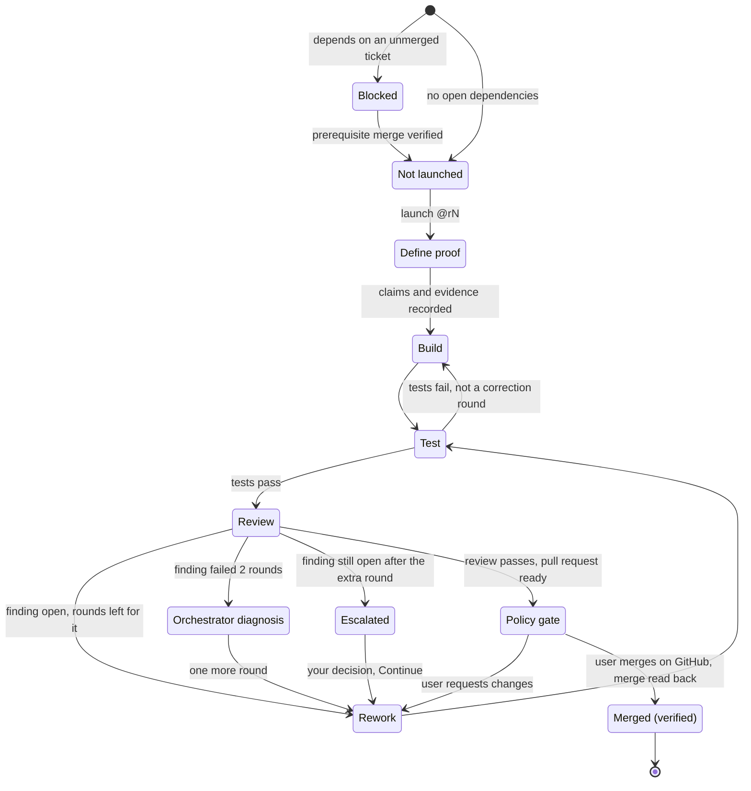

# OpenWiz workflow: controller, factory loop and proof

**Status: Proposed.** This describes intended behaviour. Nothing here is built. Every name in the examples is invented. Unresolved points are marked **Unresolved**.

**The controller** is the one Rust core that owns authoritative state, permissions, routing and coordination. **Each project orchestrator** runs its factory's workflow under the controller, and is not a second authority.

The steps use the same names as the [architecture images](architecture.md): Define proof, Build, Test, Review, Rework and Policy gate. The commands are the ones in [interface.md](interface.md).

## Who owns what

| Owner | Owns | Never |
| --- | --- | --- |
| **User** | Approving plans, launches and policy gates; merging on GitHub; setting policy | — |
| **Personal agent** | The conversation: Grill, Wayfinder and handing approved work to OpenWiz | Starting factory work by itself |
| **Controller** (the one Rust core) | **The only authority.** It owns authoritative state, permissions, routing and coordination: the plan's approved scope, **one current owner per ticket attempt**, launch requests and their receipts, state changes, per-finding correction counts and unlocking dependent tickets | Writing code, reviewing, or merging |
| **Project orchestrator** (one per factory) | Running that project's factory workflow **under the controller**: assigning the builder and reviewer sessions, diagnosing a stuck finding with a helper, and reporting each step back through controller operations | Holding authoritative state, granting permissions, widening scope, approving its own work, or merging |
| **Builder session** | Recording the ticket's claims and the evidence each needs (Define proof), then Build and Test for one ticket attempt, then a pull request | Reviewing its own work, or merging |
| **Reviewer session** | An independent review of the pull request's exact head | Building, or merging |

The builder and the reviewer are always different sessions, with their roles recorded.

**Decided:** the boundary above. Every state change goes through controller operations; a project orchestrator holds no authoritative state and grants no permissions.

**Unresolved (implementation detail):** where each project orchestrator runs, how it receives work from the controller, and how it reports back.

## Ticket states



Not drawn, to keep the diagram readable: **Parked** and **Uncertain**, which can interrupt any active step (see below), and **Archived**. Archived is a lifecycle state, never an outcome.

**On screen** (see [interface.md](interface.md)), each state shows a word, a glyph and a shape:
- **Moving:** Define proof, Build, Test, Review, Rework and Orchestrator diagnosis show `[~]`.
- **Needs you:** Escalated and a Policy gate waiting on you show `[!]`.
- **Ready:** a pull request ready to merge shows `[✓]`.
- **Blocked** shows `[x]`.
- **Quiet:** Parked shows `[‖]`, Not launched shows `[ ]`, and Merged shows `[·]` only after verification.
- **Unknown** shows `[?]`.

## Failure and rework

- **A failed test run is not a correction round.** The builder fixes it and tests again.
- **Correction rounds are counted per review finding.** Each finding the reviewer raises has its own counter.
  - **A round:** the builder corrects that finding, then the reviewer checks it again.
  - **A failed round:** the finding is still open afterwards.
- **The default rule (2 + 1):**
  1. Up to **two** failed rounds on a finding.
  2. The **project orchestrator diagnoses** the finding, with a helper. The diagnosis is **not** a round.
  3. **One** more builder and reviewer round.
  4. If the finding is still open, the ticket stops and asks you: **Escalated** on Needs you. You can:
     - **Continue** for one more round, within the same approved scope;
     - **Choose** between the offered alternatives;
     - or **park** it.
- **Both thresholds are configurable,** as whole numbers of at least 1: the rounds before the diagnosis (default 2) and the rounds after it (default 1).
- **An outcome that is not known is shown as Uncertain.** An example is a launch request that timed out. The controller reconciles it before any retry: it checks whether the request took effect. It never repeats it blindly.
- **A replaced or restarted session continues the same ticket attempt** from the controller's recorded state. It does not start over as a new attempt.

## Pause and resume

- **`park <path>@rN`** stops the item at a safe point and keeps its checkpoint. Parking never approves, launches or continues anything.
- **`resume <path>@rN`** first reconciles the current state: the pull request head, pending requests and the review status. It then continues the approved work only.
- **If the item changed after revision `rN`,** both commands are refused with "changed since you looked: re-review".

## Human approval

- **Plan.** Approving a plan (`plan <path>@rN` → Yes) covers that plan's revision only. It is not permission for every action the plan leads to.
- **Launch.** Each ticket is launched explicitly (`launch <path>@rN`).
- **Policy gates.** Your policy decides which checkpoints ask you. At each gate the factory either requests approval or proceeds only under a prior authorization that is recorded and still in force.
- **Merge.** You merge on GitHub, as an Open decision. OpenWiz never performs the merge itself.
  - **Unresolved:** whether a prior authorization may ever let a merge happen without your click, and who would perform it.
- **Every approval is bound to the exact revision you saw.** If that changes, you're asked again.

## Dependent unlock

- **A plan's tickets can depend on each other.** A dependent ticket stays **Blocked** until each prerequisite's merge is **verified**, meaning the controller has read the merge back from GitHub.
- **These do not count as merged:** an approved review, a ready pull request, or a closed issue.
- **The unlock happens once.** The dependent ticket becomes **Not launched** and is offered on Needs you to launch.
- **Unresolved:** whether one launch approval may cover a dependent ticket in advance, so that it starts by itself after the unlock.

## Worked example (invented)

Plan `example-notes` v1 has two tickets. **T2** (add search) depends on **T1** (add the note schema).

1. **Approve the plan.** A Grill produces plan v1 at revision 3. Needs you shows a Yes/No decision, and you answer Yes:

   ```text
   > plan /factories/example-notes/v1@r3 → 1 · y
   ```

   T1 is Not launched. T2 is Blocked, because it depends on T1.

2. **Launch T1:**

   ```text
   > launch /factories/example-notes/v1/spec-1/T1@r1
   ```

3. **Define proof, build, review and rework.** A builder session records T1's claims and the evidence each needs, then builds and tests T1 and opens a pull request. A separate reviewer session checks the change against those claims and requests changes. T1 goes to Rework for that finding (its first correction round), then Test, then Review again. This time the review passes, and the pull request is ready.

4. **Merge.** Your policy says merges need you, so Needs you shows an Open decision: "Merge on GitHub ↗". You merge.

5. **Unlock.** The controller reads the merge back from GitHub, and T1 becomes Merged (verified). T2 unlocks once, from Blocked to Not launched, and Needs you offers its launch. You launch T2.

6. **Park and resume.** Mid-build, you park T2 at revision 4. Later you try `resume …/T2@r3`, an older revision, and it is refused: changed since you looked. You re-read it, and `resume …/T2@r4` continues after the controller reconciles the pull request head.

7. **Uncertain.** The request that starts T2's reviewer times out, so T2 shows Uncertain. The controller checks CloudRoom for that request before trying again, and finds that the reviewer session did start. T2 continues without a duplicate reviewer.

## Proof-driven development

OpenWiz is built by proving claims, not by writing code first.

1. **Define each claim and the evidence it needs** before implementation.
2. **Build.**
3. **Verify** each claim with exactly that evidence.
4. **Have it reviewed independently**, by a separate reviewer of the exact change.

| Evidence | What it shows | What it does not show |
| --- | --- | --- |
| **Fixture tests** | The logic is right for synthetic inputs | Behaviour on a real service |
| **Disposable-backend tests** | The software works against a real but throwaway backend | Behaviour on the intended service |
| **Live observation** | What actually happened on the intended runtime, with recorded evidence | Behaviour in cases that were not observed |
| **Independent review** | A separate reviewer checked the exact change against its claims | That the change works |

Rules:
- **Tests alone never prove live behaviour.** A claim about a real service needs live evidence.
- **Formal proof needs an actual formal proof.** Say "formally proven" only when a machine-checked proof exists. Otherwise say "tested" or "observed", with the evidence.
- **A claim without its evidence stays Unverified,** however likely it seems.

In the diagrams this is the **Define proof** step, which comes before Build.

Example claims for the planned 0.0.1 inventory, as written before it was built. *Updated for 0.0.1:* what 0.0.1 actually tested, and what it did not prove, is in [evidence/0.0.1-live-check.md](evidence/0.0.1-live-check.md); the third claim's live comparison was not made.

| Claim | Required evidence |
| --- | --- |
| Listing never starts, wakes or messages a session | Fixture tests, and a live run showing that session states and activity are unchanged by listing |
| A session is grouped only by a verified mapping | Fixture tests in which unverified mappings stay unplaced, and a live run with mixed sessions |
| Status, model and freshness are shown honestly, and unknowns stay unknown | Fixture tests for missing fields, and a live run compared with CloudRoom's own view |
