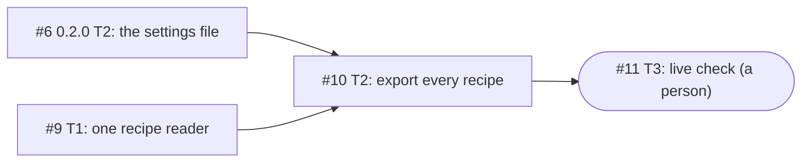

# Plan graph

Turn a confirmed grill into a **spec**, then into a **plan graph** (the spec's tickets and the "blocked by" arrows between them), and get the user's approval for the whole graph at once. It is Matt Pocock's `to-spec`, then his `to-tickets`, as one flow, with two pauses for the user: the spec first, then the graph. The orchestrator runs it.

The user's approval is what launches the graph's fleet: each ticket starts as soon as its blockers have merged, and merges by the project's merge rules in `docs/agents/fleet.md`.

## Before you start

- **The project's settings,** in `docs/agents/` (written by the `setup` skill): `issue-tracker.md` for how the project uses GitHub, `triage-labels.md` for the label names, `domain.md` for where the glossary, ADRs and grills live, and `fleet.md` for the merge rules. If they are missing, run `setup` first.
- **A confirmed grill.** If it is still open, finish it with the `grill` skill first.

## Where things go

| What | On GitHub |
| --- | --- |
| The version | A milestone named after it, for example `0.3.0` |
| The spec | An issue in that milestone. Its body holds the spec and nothing else |
| Each ticket | A sub-issue of the spec, in the same milestone, with GitHub's own "blocked by" links |
| The proposal, the confirmation and each approval | Comments on the spec issue, never edited once posted |

Notes on progress go in comments too, never in a body. So an edit to the body of the spec or of a ticket is always a change to the plan, with one exception: a ticked task box, which the revision reads as unticked ("Is an approval current?"), so a box ticked out of habit stops nothing.

## 1. Read

- **The confirmed grill,** every round of it, plus the glossary and the ADRs (where `docs/agents/domain.md` says).
- **The code the spec will touch,** so the plan starts from how things are today.
- **The version being built,** when you are planning the next one: its specs and its tickets (see "Across versions").

Every decision in the spec comes from the grill, the glossary, an ADR or the code. The grill already interviewed the user, so this step only gathers. A decision that none of them settles goes back to the user as a grill round (the `grill` skill), before the spec is written.

Done when you can point at the grill line, ADR or file behind every decision you are about to write.

## 2. Write the spec

1. **Find the seams:** the places where tests will check the work. Prefer seams that already exist, as high up as possible, and as few as possible: one is ideal. They go in the spec's Testing Decisions, and the user confirms them with the spec.
2. **Write the spec** from the template below, in the glossary's words, keeping to the ADRs.
3. **Publish it** as an issue in the version's milestone (create the milestone if the version has none yet). Give it no label: the spec is not a ticket.

Done when the spec issue is in the milestone and every section of the template is filled (Live check only when the spec needs one).

## 3. Pause: the user confirms the spec

1. **Show the user the spec in at most 10 lines,** with the issue's link, and ask them to confirm it.
2. **If they change something,** edit the spec's body and show it again.
3. **When they confirm,** post the "spec confirmed" comment, with their words exactly.

The tickets wait for that comment. Done when it is posted.

## 4. Propose the tickets

Cut the work the way Matt's `to-tickets` does:

- **Tracer bullets.** Each ticket is a narrow but complete path through every layer the work crosses (for example data, server, page and tests), never one layer on its own. When it is done, it works and can be shown or checked by itself.
- **One fresh context window.** Each ticket is small enough for one builder to hold all of it at once.
- **Clean-up first.** Any change that makes the rest easier ("make the change easy, then make the easy change") is its own ticket, and blocks the tickets it helps.
- **Wide refactors** are the one exception to tracer bullets: a mechanical change, like renaming something used everywhere, that would break the whole code base in one go. Expand first (add the new form beside the old), then move the code over in batches, one ticket each, blocked by the expand, then contract (remove the old form) in a ticket blocked by every batch.

Then add ours:

- **Owned paths.** Give each ticket the files and folders it may change; they are for scheduling only. Two tickets that would touch the same file never run at once: give them a "blocked by" arrow instead, the one that should land first blocking the other.
- **Arrows only for real gates.** A ticket is blocked only by the exact tickets it cannot start without, never by a whole spec or version. An arrow may point at a ticket in another spec, or in the version being built (see "Across versions").
- **Contracts, not code.** When a ticket builds on what another one makes, it depends on a **contract**: a file that pins down the shared interface (an API's routes, a file format), agreed before either is built. List it under the ticket's **Relies on**. If the contract does not exist yet, the ticket that writes it blocks every ticket that relies on it. A ticket relies on what the interface says, never on how another ticket builds it.
- **Proof.** Each ticket names the spec's Proof claims it proves, and how.
- **A person's ticket.** Work only a person can do (a live run on the user's machine, an acceptance) is a ticket too, marked as one, so the graph shows it.

Then show it:

1. **Post the "proposed plan graph" comment** on the spec issue: a picture of the graph (GitHub draws the `mermaid` block, on a phone too) and a short table.
2. **Send the user its link and the table,** with one round of at most three questions: is each ticket the right size, are the arrows right, and is anything missing? Drop any question the grill already settled.
3. **Change the proposal on their answers** and show it again, until they accept it.

Done when the user has accepted the proposal.

## 5. Write the tickets

1. **Create each ticket** from the ticket template, blockers first, so every arrow points at a real issue number. Give it the spec as its parent and its blockers as GitHub's own "blocked by" links, with no label yet (commands below).
2. **Read the graph back from GitHub** (commands below) and compare it with the accepted proposal. Fix any difference on GitHub, then read it back again.
3. **Post the "plan graph written" comment:** the picture and the table, as read back, now with issue numbers. Send the user its link, and say what approving does: every ticket starts as soon as its blockers have merged, and merges by the project's merge rules.
4. **If the user changes something,** change it on GitHub, read the graph back, and post the comment again. A change to the spec itself goes back to step 3 first.

Done when every ticket has its parent, its milestone and its links, and the graph read back from GitHub matches what the user accepted.

## 6. Record the approval

1. **Wait for a clear approval** of this graph, such as "approve" or "approved". A "looks good" that also asks for a change, or a reply about something else, is not one: make the change, or ask again.
2. **Record it first.** Take the **revision** and its fingerprint (see "Is an approval current?" below), read the graph back for the table, then post the "plan graph approved" comment: the user's words exactly, the revision's number (1 at the first approval, then 2, 3, … for the same spec), the table, the fingerprint and the revision text.
3. **Then label every ticket in it,** with the label its row names: `ready-for-agent`, or `ready-for-human` for a person's ticket (their names here are in `docs/agents/triage-labels.md`). The record comes first, so no ticket is ever ready without an approval behind it.
4. **Read the labels back.**
5. **Hand over to the `launch-fleet` skill:** its next check starts every ticket whose blockers have all merged.

Done when the approval comment is on the spec issue and is current, every ticket in its table has exactly the label its row names, none has `held`, and no other ticket of the spec has a ready label.

## Is an approval current?

An approval covers one **revision**: the spec's body, and each of its tickets' number, blockers, body and title, exactly as they were when the user approved. `launch-fleet` must ask this before it starts any ticket of the spec. Ask it yourself after every approval.

1. **Find the spec's latest approval:** its last comment that starts `**Plan graph approved by`.
2. **Take the revision as it is now:** `sh revision.sh <spec> > now.txt` (`revision.sh` is beside this skill), then `sha256sum now.txt` (on macOS, `shasum -a 256 now.txt`). That hash is the fingerprint.
3. **Compare it with the approval's `Fingerprint:` line.** The same: the approval is current. Different, or no approval at all: it is stale, so start nothing under this spec until the user approves the plan as it now stands. To see what changed, compare `now.txt` with the approval's revision text.

The revision text, version 2, is exactly these lines, each ending in a newline:

```text
plan-graph revision v2
spec #<spec> body sha256 <hash>
ticket #<n> blocked-by <#a #b, or none> body sha256 <hash> title <title>
```

- One `ticket` line for each sub-issue of the spec, in number order. Its blockers are in number order, separated by spaces.
- A `<hash>` is the SHA-256, in lowercase hex, of what `gh issue view <n> --json body --jq '.body'` prints (the body, then one newline), with every ticked task box read as unticked: on each line that starts with spaces or tabs (or none), a `-`, `*` or `+`, then spaces or tabs, an `[x]` or `[X]` followed by a space, a tab, a carriage return or the line's end becomes `[ ]`. Nothing else changes: a box's words, its bullet and its indent all count.
- Labels, comments, a ticket's state (open or closed), its milestone and whether its boxes are ticked are not in it. So labelling (a hold included), progress notes, ticked boxes and merges never make an approval stale; any change to the plan does.
- **An approval recorded under version 1** (its revision text starts `plan-graph revision v1`) is stale: no version 2 text can match its fingerprint, even for the same plan. The user must re-approve: record the next revision as in step 6, with "Changed since revision <N>: the revision text's version, v1 to v2", plus any real change the two texts show.

## Changing an approved graph

Any change to the plan after an approval needs the user's approval again: a ticket added or dropped, an arrow added or removed, or an edit to the spec's body or to a ticket's title or body. **Hold first, then change,** so the five-minute loop never starts a changed ticket under its old approval, even if it checks between two of your steps.

1. **Hold the tickets the change touches.** Put the `held` label on each one that has no builder yet and take its ready label off, in one edit, then read the labels back and check: `held` on, the ready label off. `held` is the fleet's label for a held ticket (`docs/agents/fleet.md`); if the project has none yet, create it once first (commands below). The tickets it touches:
   - each ticket whose title, body or arrows will change, and each one you will drop;
   - for a change to the spec's body, every ticket of the spec that has no builder yet.

   If you can't tell whether a ticket has a builder, hold it anyway: the labels only decide whether a builder may start, so holding a running ticket stops nothing.
2. **Tell the running builders.** A ticket already being built keeps going: tell its builder what will change, in a comment on its ticket. For a change to the spec's body, tell the builder of every running ticket of the spec.
3. **Then change the plan on GitHub** (commands below). A new ticket gets no label. A dropped ticket leaves the spec, loses its `held` label if it has one, and is closed, with a comment saying why: only a merge closes a ticket that stays in a spec.
4. **Show the user only what changed:** that part of the picture, and the changed rows.
5. **On their approval,** record it as in step 6, with the next revision number and a "Changed since" line. Only then release each held ticket in one edit, its ready label back on and `held` off, label the new ones, and read the labels back.

From step 3 until the new approval, the fingerprint no longer matches, so `launch-fleet` starts nothing under the spec. The hold covers the moments before that, and any loop that only looks at labels. Its `held` label also tells the fleet's view that the ticket is held, not unapproved.

**A ticket held for a changed contract.** When `launch-fleet` holds a ticket because a merge changed a contract it relies on ("contract changed: re-approve"), check that it has `held` and no ready label (fix either, and read them back), read what changed, update the ticket if it needs it, and ask the user to re-approve just that ticket. Record it as above, then release it as in step 5, its ready label back on and `held` off: the new revision is what releases the hold.

Done when the latest approval is current and every held ticket has its ready label back and no `held` label.

## Across versions

- **One version ahead, at most.** While a version is being built, you may plan the next one, against what the version being built will be once its tickets are done. Never plan two ahead: plans that far out go stale.
- **Arrows into the version being built.** A ticket of the next version may be blocked by exact tickets of the version being built. It starts as soon as those merge, because `launch-fleet` works from every approved graph at once.
- **Releases stay in order.** Code reaches `main` as soon as it is reviewed, whatever its version. Each version's release branch is cut when its last ticket merges, and live checks run in version order. So a ticket of the next version can merge early, but its version's live check waits for the one before.

## Commands

GitHub CLI 2.94 or later. `docs/agents/issue-tracker.md` has the rest. Write every body to a file first and pass it with `--body-file`.

```sh
# Before the first write of a session: is this the right repository?
gh repo view --json nameWithOwner

# The version's milestone; create it only if it is missing
gh api 'repos/{owner}/{repo}/milestones?state=all' --jq '.[] | {number, title, state}'
gh api --method POST 'repos/{owner}/{repo}/milestones' -f title='<version>'

# The spec
gh issue create --title '<version> spec: <name>' --milestone '<version>' --body-file spec.md

# A comment on the spec issue, or on a ticket
gh issue comment <n> --body-file comment.md

# A ticket (leave out --blocked-by when nothing blocks it)
gh issue create --title '<version> <id>: <name>' --milestone '<version>' --parent <spec> --blocked-by <n>,<n> --body-file ticket.md

# Hold tickets before a change: held on and the ready label off, in one edit (then read the graph back).
# First, the held label: this prints held if the project has it; if it prints nothing, create it, once
gh label list --search held --json name --jq '.[] | select(.name == "held") | .name'
gh label create held --description "Held: waits for the user's approval"
gh issue edit <n> <n> <n> --add-label held --remove-label 'ready-for-agent'
gh issue edit <n> --add-label held --remove-label 'ready-for-human'

# Change the spec's body, or a ticket's title, body or arrows
gh issue edit <n> --title '<version> <id>: <name>' --body-file ticket.md
gh issue edit <n> --add-blocked-by <n> --remove-blocked-by <n>

# Drop a ticket: out of the spec, its held label off (if it has one), a comment saying why, then closed
gh issue edit <spec> --remove-sub-issue <n>
gh issue edit <n> --remove-label held
gh issue close <n>

# Read the graph back: how many tickets the spec has (then their numbers), then one table row per ticket
gh issue view <spec> --json subIssues --jq '.subIssues.totalCount, (.subIssues.nodes[].number)'
gh issue list --milestone '<version>' --state all --limit 1000 --json number,title,parent,blockedBy,labels --jq 'map(select(.parent.number == <spec>)) | sort_by(.number) | .[] | "| #\(.number) | \(.title) | \([.blockedBy.nodes[].number | "#\(.)"] | join(", ") | if . == "" then "none" else . end) | \([.labels[].name] | join(", ") | if . == "" then "none" else . end) |"'

# The labels of an approval, one command per label
gh issue edit <n> <n> <n> --add-label 'ready-for-agent'
gh issue edit <n> --add-label 'ready-for-human'

# Release held tickets once the new approval is recorded: the ready label back on and held off, in one edit
gh issue edit <n> <n> --add-label 'ready-for-agent' --remove-label held
gh issue edit <n> --add-label 'ready-for-human' --remove-label held

# The revision: revision.sh runs the subIssues read above, then these two, for the spec and for each ticket
gh issue view <n> --json body --jq '.body'
gh issue view <n> --json number,title,blockedBy --jq '"#\(.number)\t\([.blockedBy.nodes[].number] | sort | map("#" + tostring) | join(" ") | if . == "" then "none" else . end)\t\(.title)"'
```

The read-back is right when it prints one row per ticket, as many as `totalCount` (the first number the `subIssues` read prints). Fewer rows means a ticket is missing from the milestone. Its columns are the ticket, its title, its blockers and its labels. A ticket's blockers may be in another spec or version; they still show by number.

## Templates

**The spec.** Title: `<version> spec: <name>`. Matt's template, plus our **Proof** and **Live check**:

```md
## Problem Statement

The problem the user faces, from the user's side.

## Solution

The solution, from the user's side.

## User Stories

A long, numbered list that covers every part of the work:

1. As <an actor>, I want <a feature>, so that <a benefit>.

## Implementation Decisions

The decisions made: the modules built or changed and their interfaces, technical clarifications, architecture, schema changes, contracts, and specific interactions. No file paths or code: they go stale fast. (One exception: a snippet from a prototype that pins a decision down better than words, such as a state machine or a schema, trimmed to the decision and marked as from a prototype.)

## Testing Decisions

What makes a good test here (it checks behaviour from the outside, not how the code does it), what will be tested, the seams, and prior art: similar tests already in the code.

## Proof

| Claim | Evidence |
| --- | --- |
| <id> <what will be true> | <what proves it: a test run red first, a live observation, or a review> |

## Live check

The smallest real test on the user's own machine or account that honestly proves the spec, sized to its risk, and what the user does in it. Only when the spec touches their machine or account; otherwise leave this section out.

## Out of Scope

What this spec does not do.

## Further Notes

Anything else: the grill it came from, sources and credits.
```

**A ticket.** Title: `<version> <id>: <name>`, where `<id>` is short and unique in the version (T1, T2, …; or a letter per spec, A1, B1, when the version has several). Matt's ticket, plus our **Owned paths**, **Relies on** and **Proof**. Its blockers are GitHub's own links, so the body never lists them:

```md
## Parent

Ticket <id> of spec #<spec> (<version>).

## What to build

The behaviour this ticket makes work, end to end, from the user's side. No file paths: they go under Owned paths.

## Owned paths

<each file and folder this ticket may change, in backticks; a folder ends in />

## Relies on

<each contract file this ticket relies on, in backticks; or the word nothing>

## Acceptance criteria

- [ ] <criterion>

## Proof

<the spec's Proof claims this ticket proves, and its evidence, red first>
```

A person's ticket adds `## Done by` after Parent: `a person: <who, and what they do>`.

**The picture,** in each graph comment. One box per ticket, an arrow from each blocker to the ticket it blocks, a round box for a person's ticket, and a box with its version for a blocker outside this spec. Once the tickets are written, each box starts with its issue number:

````md

````

In the proposal, before any ticket is written, the boxes have no numbers: `T1["T1: one recipe reader"]`.

**The comments** on the spec issue, each opening with its bold first line:

```md
**Spec confirmed by <User>, <YYYY-MM-DD>:** "<their words, exactly>"

Next: the proposed tickets, for <User>'s review.
```

```md
**Proposed plan graph,** for <User>'s review. No ticket is written yet.

<the picture>

| Ticket | Delivers | Blocked by | Owned paths | Relies on |
| --- | --- | --- | --- | --- |
| T1: <name> | <the behaviour, in a few words> | <ids, or none> | <paths> | <contract files, or nothing> |

Three questions: is each ticket the right size, are the arrows right, and is anything missing?
```

```md
**Plan graph written,** waiting for <User>'s approval. Approving starts every ticket as soon as its blockers have merged, and each one merges by the project's merge rules.

<the picture, with issue numbers>

| Ticket | Title | Blocked by | Labels |
| --- | --- | --- | --- |
<the rows, as read back>
```

`````md
**Plan graph approved by <User>, <YYYY-MM-DD>, revision <N>:** "<their words, exactly>"

Changed since revision <N - 1>: <what changed>.

| Ticket | Title | Blocked by | Label |
| --- | --- | --- | --- |
<the rows, as read back just before labelling, each with the label it gets>

Fingerprint: `<the SHA-256 of the revision text>`

<details><summary>Revision text</summary>

```text
<the revision text, exactly as revision.sh printed it>
```

</details>
`````

Leave out the "Changed since" line at revision 1. Every approval lists the whole graph and fingerprints the whole revision, so the latest approval alone says what is approved.

## Licence

Adapted from Matt Pocock's `to-spec` and `to-tickets` skills (`github.com/mattpocock/skills` @ `a496f55`), which carry this notice:

Copyright (c) 2026 Matt Pocock

Permission is hereby granted, free of charge, to any person obtaining a copy
of this software and associated documentation files (the "Software"), to deal
in the Software without restriction, including without limitation the rights
to use, copy, modify, merge, publish, distribute, sublicense, and/or sell
copies of the Software, and to permit persons to whom the Software is
furnished to do so, subject to the following conditions:

The above copyright notice and this permission notice shall be included in all
copies or substantial portions of the Software.

THE SOFTWARE IS PROVIDED "AS IS", WITHOUT WARRANTY OF ANY KIND, EXPRESS OR
IMPLIED, INCLUDING BUT NOT LIMITED TO THE WARRANTIES OF MERCHANTABILITY,
FITNESS FOR A PARTICULAR PURPOSE AND NONINFRINGEMENT. IN NO EVENT SHALL THE
AUTHORS OR COPYRIGHT HOLDERS BE LIABLE FOR ANY CLAIM, DAMAGES OR OTHER
LIABILITY, WHETHER IN AN ACTION OF CONTRACT, TORT OR OTHERWISE, ARISING FROM,
OUT OF OR IN CONNECTION WITH THE SOFTWARE OR THE USE OR OTHER DEALINGS IN THE
SOFTWARE.
